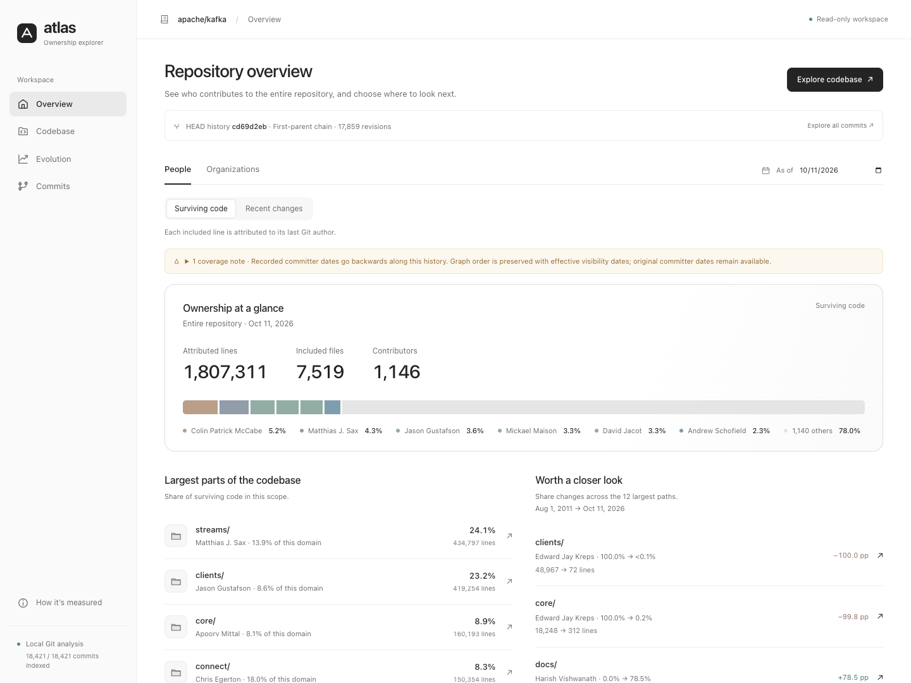
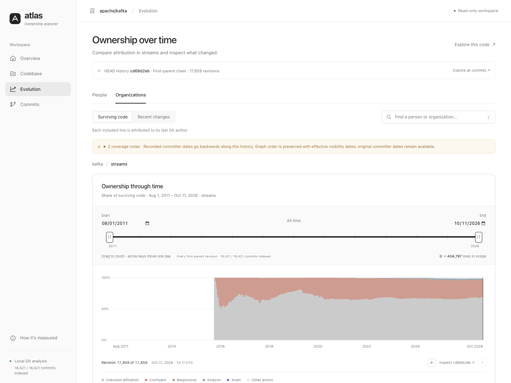

# Git Contributor Insights

Explore **who contributed the code that exists today, and how that attribution changed over time** — by person, organization, directory, and file.

The local **Ownership atlas** gives each question its own workspace: an overview to choose where to investigate, a codebase explorer to understand one snapshot, an evolution view to compare dates, and a commit catalogue to inspect work across merged branches. It runs from one Go binary, serves only on localhost, and never uploads or modifies the analyzed repository.



## Get started

Requires Go 1.25.3 or newer to build and Git on your PATH for ownership analysis.

```sh
go build -o ghca ./cmd/ghca
./ghca explore /path/to/repository
# Open http://127.0.0.1:8787/overview
```

This is a local application: the Go binary includes the browser UI and listens on `127.0.0.1`. No hosted service or separate frontend server is required. `explore` opens an existing local Git checkout; it does not clone a repository automatically.

Keep repositories being analyzed outside this project's checkout, for example in `~/code/kafka`. The public project contains the application, tests, documentation and example affiliation configurations. Analyzed checkouts and generated SQLite indexes are local runtime data, not part of the project. Indexes default to the operating system's user cache directory and are isolated by repository path.

Today, each explorer instance opens one repository. Several repositories can run locally on different `--port` values, each with its own index. A repository picker within one application is a future extension: it should register external local checkouts and keep their indexes separate, without embedding those repositories in this project.

Choose the history and resolution you need:

```sh
./ghca explore /path/to/repository \
  --since 2020-01-01 --until 2026-10-01 \
  --window-days 90 --config ownership.yaml
```

The explorer stores the exact ownership state of **every commit reachable from the checked-out HEAD** in a persistent local SQLite database. This includes every intermediate state on merged branches, even code added and removed before a merge. Commit parents, authors, activity and available ref names are preserved. The browser opens while indexing runs and shows indexed commits out of the total; it does not substitute a sample.

Completed commit states survive interruption and are reused on the next launch. New commits extend the existing index. Databases created by the previous mainline-only version retain their existing snapshots while the missing branch states are added. Changes to attribution configuration or identity mappings produce a separate analysis namespace, preserving correctness. The default database lives under the operating system's user cache directory; use `--database /path/to/ownership.sqlite` to choose a persistent location. The analyzed repository is never modified.

Git extraction runs across multiple commits in parallel, with one global worker limit; atomic writes retain parent-before-child order. Unchanged file attribution is inherited from the exact first parent, and SQLite stores changes with periodic full checkpoints. Every commit remains individually reconstructible. The worker count adapts to available CPUs (up to 12), or can be set with `--workers`.

The browser receives every timeline point using lossless `changes-v1` encoding: contribution values are absolute replacements for a person/organization pair, omitted pairs retain their previous values, and a pair with both values zero is removed. The first point establishes the initial values. SHA, date and point order are preserved even when attribution is unchanged. The CLI JSON export retains full contribution values at every point.

Interactive queries read the stored aggregate changes directly and apply activity entries and expirations in one ordered pass. They do not rebuild a dense matrix of every contributor at every commit. The chart retains all exact states while sharing one pointer hit area; previous/next controls also expose commits with identical timestamps. Dragging the period handles updates the controls immediately, keeps the previous plot visibly marked as updating, and cancels superseded requests.

## Explore a question

| Workspace | Question | Next action |
|---|---|---|
| **Overview** | Where should I look closer? | See the ownership distribution, explore the largest paths, or investigate a share change. Suggestions compare the 12 largest paths in the selected scope; the dates and ranking are explicit. |
| **Codebase** | Who accounts for this part of the code at this date? | Drill into a folder or file, switch People / Organizations, and select a contributor to trace their footprint. |
| **Evolution** | How did ownership evolve along this history? | Follow one first-parent history, zoom into dates, and inspect contributors ranked by percentage-point change alongside absolute line counts. |
| **Commits** | What happened before and during a merge? | Search every indexed commit, inspect its exact code state, follow its parents, or explore the history ending at that commit. |

Scope, actor, measurement and dates follow you between workspaces. URLs retain the analysis context, and browser Back restores navigation. Unknown affiliations remain part of every denominator.

The period slider selects all configured history by default. Move either handle to zoom into a period, enter precise dates, or choose **All time** to reset it. Zoom queries the database and returns every commit on the selected history within the range. The default history follows HEAD through its first parents; selecting another history follows that commit through its own first parents. Parallel branches are never concatenated into a false chronological sequence. The Commits workspace exposes the full indexed graph through its catalogue and parent links. The chart rescales and recalculates its legend from contributors in the selected path and period, while actor colors remain consistent. Both handles support touch and keyboard navigation. A shared link restores its selected dates and scope.



Workspaces have direct URLs: `/overview`, `/codebase`, `/evolution`, and `/history`. A selected history uses `tip=<full-commit-SHA>`; `/history?commit=<full-commit-SHA>` opens an exact commit, including a commit from a merged branch. For example, `/evolution?path=db.go&from=2017-01-01&to=2026-10-01` compares a file between two dates; `/codebase?path=db.go&at=2020-07-01` opens a snapshot. People use their Git email (`person=`), organizations their name (`organization=`). Default filters are omitted. The interactive explorer resolves date boundaries against the complete index. Multiple revisions with the same timestamp remain distinct in the timeline. Legacy fixed analyses resolve unavailable dates to their preceding available snapshot. Previously shared hash links convert automatically.

Click a timeline state or a row in Commits to inspect an exact SHA. The inspector shows the commit metadata and parents, with an action to explore its history. Commits sharing the same timestamp remain separately accessible. Ref labels are the names that exist when the index opens; deleted historical branch names cannot be recovered from Git commits alone.

In a folder, selecting a person or organization opens an inspector with attributed lines, share of the full scope, and affected files. Each path row shows ownership within that path and an absolute attributed-line count. **Trace over time** brings that selection into Evolution, where the actor's line counts and the scope's total appear together. This makes a share decrease interpretable: the actor's lines can shrink while the surrounding code grows.

Opening a file goes straight to its full-width **source at the selected date**, with the selected person's or organization's surviving lines highlighted. A compact selector in the reader switches contributors or organizations without a side panel. **Attributed passages** keep three lines of surrounding context and the original line numbers; **Full file** reveals the rest. Each attribution links to its exact commit. Source is read lazily from the frozen revision, checked against indexed attribution totals, and cached; changing actors does not rerun blame. Recent changes, including deleted lines, remain available in Supporting commits.

**Supporting commits** expand beside the explored paths; opening a commit shows its real local Git patch. Evidence preserves original filenames for patches, while path navigation opens the observed file at its supporting snapshot. **How it’s measured** explains temporal conventions, exclusions, affiliation rules and coverage warnings.

## Two distinct views of ownership

| View | Measure | What it helps explain |
|---|---|---|
| **Surviving code** | Lines present in a historical tree, attributed by `git blame` to their last modifying author. Includes text such as code, tests and documentation, after the stated exclusions. | Which authors' contributions still make up this part of the repository? |
| **Recent changes** | Additions + deletions from non-merge commits reachable from that snapshot, within a trailing window of recorded committer dates. | Who has recently been changing this part of the repository? |

These are attribution measures, **not certifications of expertise, responsibility, employment, legal ownership, or governance authority**. A formatting change or rewrite can change attribution. A falling share may result from code deletion or growth elsewhere, without a handover. Whole-file rename tracking in blame does not turn folders into stable semantic components.

Shares use the selected metric's total in the selected path as their denominator. Unknown affiliations stay in that total. A person may have contributions attributed to more than one organization; organizations do not represent that person's current employer.

### Time and evidence

- Every commit reachable from the checked-out HEAD has an indexed ownership snapshot, including all parent branches of merges. Unmerged branches, unreachable commits and working-tree edits are outside this HEAD-scoped analysis.
- An Evolution chart follows one first-parent chain to keep each successive state meaningful. All other indexed states remain accessible through Commits, parent links and history selection.
- Each selected timeline follows its own first-parent graph order. When commit clocks run backwards, effective dates are clamped to the preceding revision's date; original committer dates remain available. Recent-activity windows use recorded committer timestamps. Git does not always record when a branch's changes reached the main branch.
- Blame follows the selected tree's ancestry. Historical organization affiliation is evaluated at the original contribution's **author date**.
- Recent activity excludes merge commits to avoid attributing an entire branch's work to the merger; merge conflict resolutions are therefore not represented in that metric.
- Ownership changes at revision boundaries, with no interpolation. Recent-change series also include window-expiration events, so activity can fall between commits. Exact range boundaries are evaluated from the index.
- Each included file contributes its whole measured count. All supporting attribution and activity commit references are retained; the interface reveals longer lists progressively.
- Shallow history, unavailable evidence and exclusions are surfaced. Excluded files are not part of the denominator.

## Organizations and identities

Without configuration, organization attribution is **Unknown affiliation**. Personal and masked email addresses do not establish community independence. The current repository mailmap is used to consolidate identities across all snapshots; this corrects identities without rewriting historical affiliations.

People with the same non-empty Git display name are grouped across email addresses, ignoring case and repeated spaces. Their surviving lines, recent activity and evidence are combined consistently across the chart, codebase and exact-commit inspector. Profiles retain all email aliases and indicate when grouping comes from a matching name; it is a heuristic and can group homonyms. Previously shared email and identity links still resolve. Organizations remain attributed from each original commit's email and date. This grouping reuses the existing SQLite attribution without recalculating or rewriting snapshots.

Reuse the existing `vendors` domain format, and optionally add historical affiliation intervals:

```yaml
vendors:
  Example Corp:
    domains: [example.com]

people:
  - email: alex@example.net
    affiliations:
      - organization: Example Corp
        from: 2020-01-01
        until: 2023-07-01
      - organization: Another Company
        from: 2023-07-01
```

Affiliation intervals are **start-inclusive and end-exclusive**. A configured person's uncovered dates remain unknown. Domain rules are declared inference, not verified employment. Historical rules take priority. The legacy `github_companies` field does not perform a GitHub lookup.

See [the bbolt domain example](examples/bbolt-domains.yaml) for a configuration grounded in corporate email domains present in a public repository. It intentionally leaves personal, masked and unmatched addresses unknown.

## Run the real-repository example

For Apache Kafka, clone the full history of `trunk` and index every commit reachable from it:

```sh
git clone --single-branch --branch trunk https://github.com/apache/kafka.git /tmp/apache-kafka
# Optional local Git acceleration cache; changes no commits or working files.
git -C /tmp/apache-kafka commit-graph write --reachable --changed-paths
./ghca explore /tmp/apache-kafka --config examples/kafka-domains.yaml
```

Explore `clients/`, `core/`, `streams/`, `connect/` or `metadata/` in Codebase, then compare their attribution in Evolution. The [Kafka configuration](examples/kafka-domains.yaml) recognizes corporate email domains recorded in the history. Personal, GitHub-masked and `apache.org` addresses remain unknown; an Apache committer address does not identify an employer.

On a larger machine, add `--workers 32` to raise the shared Git concurrency limit. Preparation uses a bounded ring of four commits per worker ahead of ordered database writes. The optional [Git commit graph](https://git-scm.com/docs/git-commit-graph) above caches ancestry and changed paths inside `.git`; the explorer itself does not write to the analyzed repository.

For a smaller repository:

```sh
git clone https://github.com/etcd-io/bbolt.git /tmp/bbolt
./ghca explore /tmp/bbolt \
  --since 2017-01-01 --until 2026-10-01 \
  --config examples/bbolt-domains.yaml
```

In Codebase, open `db.go`, select People, then choose **Compare over time**. Compare the first and last snapshots and inspect both Ben Johnson's remaining lines and his percentage: this separates removed or replaced lines from growth by other authors. Switch to Organizations to see the **configured-domain share**, including the unknown portion. This is real history; the configuration is an explicit interpretation of email domains.

## CLI reference

```sh
# Interactive local explorer
ghca explore /repo [flags] --port 8787

# Structured export, with the same model and evidence
ghca ownership /repo [flags] > ownership.json

# Original terminal report of commit volumes
ghca analyze /repo --breakdown quarter --since 2024-01-01
```

Shared `explore` and `ownership` flags:

| Flag | Default | Meaning |
|---|---|---|
| `--since` | Start of history | First snapshot date |
| `--until` | HEAD date | Last snapshot date, inclusive for date-only input |
| `--database` | User cache directory | Persistent SQLite index; reuse across launches |
| `--window-days` | `90` | Trailing window for recent changes |
| `--config`, `-c` | None | Domain rules and dated affiliations |
| `--workers`, `-w` | `0` | Automatic CPU-based parallelism, up to 12 Git workers; set 1–32 to override |

The `ownership` export also defaults to the complete index: `series` contains every timeline point, and `snapshots` contains the full start/end file states. For compatibility, only the export command accepts explicit `--snapshots` or `--interval` options for a legacy sampled export; the explorer always uses the complete index.

Dates accept `YYYY-MM-DD` or RFC3339. `explore --port 0` selects a free local port. Ctrl+C stops the server. SQLite is embedded in the binary. No API token, database server, frontend build or remote service is required.

The original `analyze` command remains available for compatibility. Its legacy email-based `community` grouping and commit counts should not be interpreted as independence, health, or ownership. Use `ownership` or `explore` for the new attribution model.

## Development

```sh
go test ./... -count=1 -short
node --test pkg/explorer/*.test.cjs
go build -o ghca ./cmd/ghca
```

- `pkg/ownership`: historical Git extraction, persistent SQLite index, identity and affiliation model.
- `pkg/explorer`: embedded browser interface and read-only evidence API.
- `cmd/ghca`: CLI commands.
- `pkg/analyzer`, `pkg/tui`: original quantitative terminal report.

The ownership tests build small, controlled Git histories to verify attribution, complete reachable-commit coverage, branch states before merges, parent navigation, migration from mainline-only databases, persisted restart/resume, incremental indexing, date boundaries, frozen revisions, cache correctness, aliases, affiliations and exclusions. The evidence server tests cover index progress, retry, pagination, history-specific date bounds, date validation, cancellation, concurrent queries and access to supporting Git patches.

MIT license. Built with Go, Git, Cobra, go-git and Lip Gloss.
